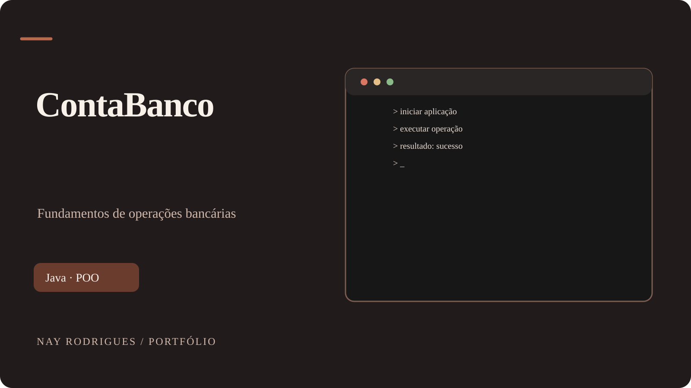

<div align="center">



# Conta Banco

Estudo de conceitos básicos de Java aplicados a uma conta bancária

**Estudo Java**

</div>


Este repositório contém a resolução do desafio **ContaBanco** do Bootcamp Santander/DIO.

## 🚀 Como rodar
1. Clone o repositório:
   ```bash
   git clone https://github.com/nayjoplin/ContaBanco.git
   cd ContaBanco/src
